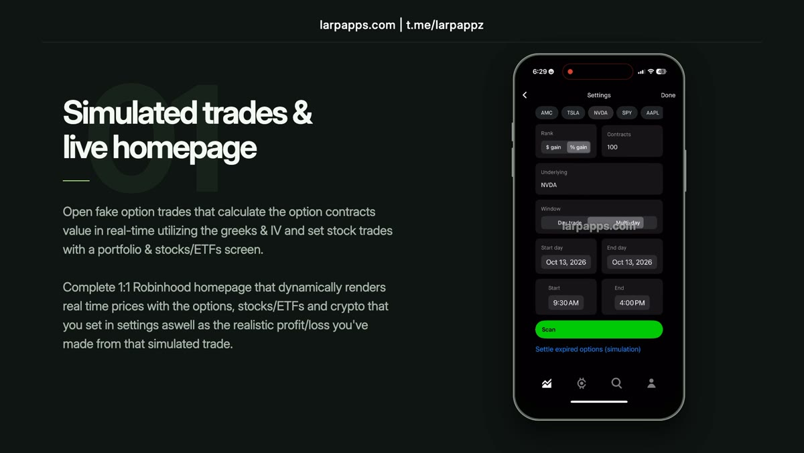

# Larp Robinhood iOS App Clone — Portfolio & Options UI Demo

An **unofficial Robinhood-style iPhone app simulation** from Larp Apps. Explore a native-feeling investing interface with portfolio charts, stock and ETF views, options positions, and connected trade history. It is intended for interface demonstrations and fictional scenarios; displayed activity is not evidence of a real brokerage account or investment performance.

 

**Quick links:** [Larp Apps website](https://larpapps.com) · [Robinhood product page](https://larpapps.com/robinhood) · [Telegram community](https://t.me/larpappz)

## Watch the Robinhood showcase

[Watch the full Robinhood showcase video (MP4, 1 min 58 sec)](media/robinhood-showcase.mp4). The video demonstrates the simulated app interface and its portfolio and options screens.

## What the Robinhood-style demo includes

- Investing home screen with a portfolio chart, multiple time ranges, buying power, and holdings.
- Stock and ETF detail views with charts, prices, and position information.
- Options positions, contract details, and simulated open and close flows.
- Linked filled-order screens, trade history, and realized profit and loss views.
- News, options chains, and a strategy-oriented interface for walkthroughs.

The product page has the current feature overview, previews, and availability. This repository is a **product overview**, not the app source code or an official download channel.

## Looking for a Robinhood iOS UI demo?

If your search is for a *Robinhood app clone*, *Robinhood-style portfolio demo*, or *options trading UI simulation for iPhone*, start with the [Larp Robinhood product page](https://larpapps.com/robinhood). For updates and questions, [join the Larp Apps Telegram](https://t.me/larpappz).

## Important distinction

Larp Apps is independent and is not affiliated with, endorsed by, or sponsored by Robinhood Markets, Inc. This simulation is not a brokerage service. Do not use a simulated screen, trade, statement, or balance as proof of assets or investment results; verify financial claims with the official provider.
